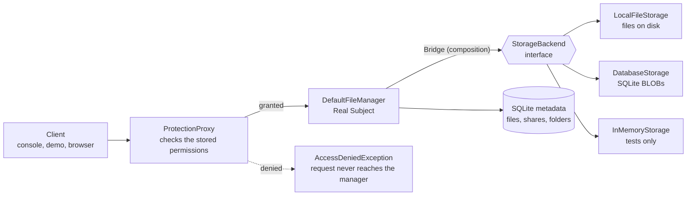
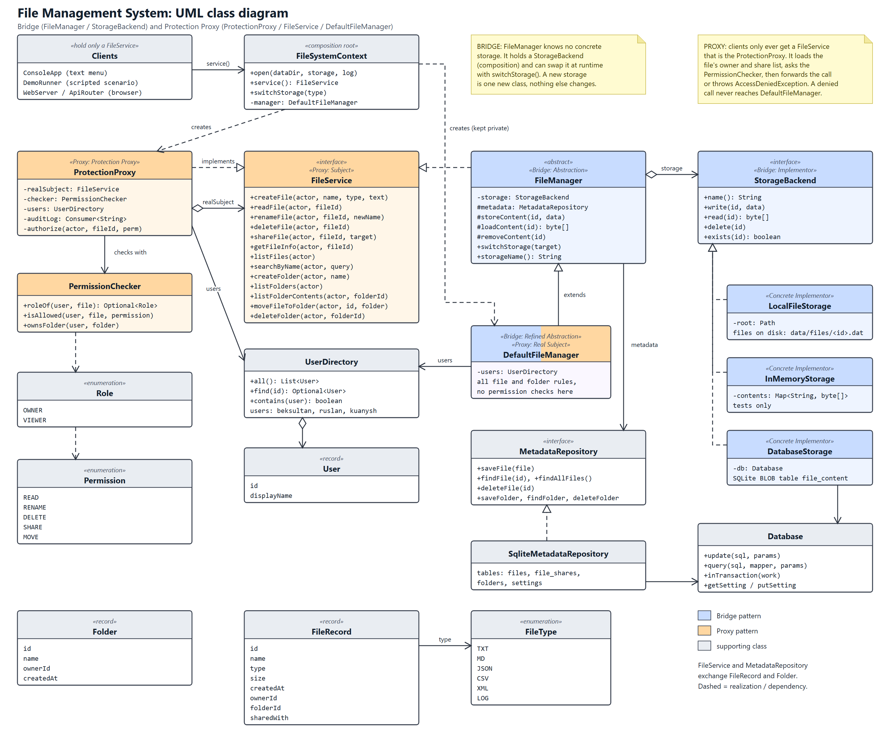
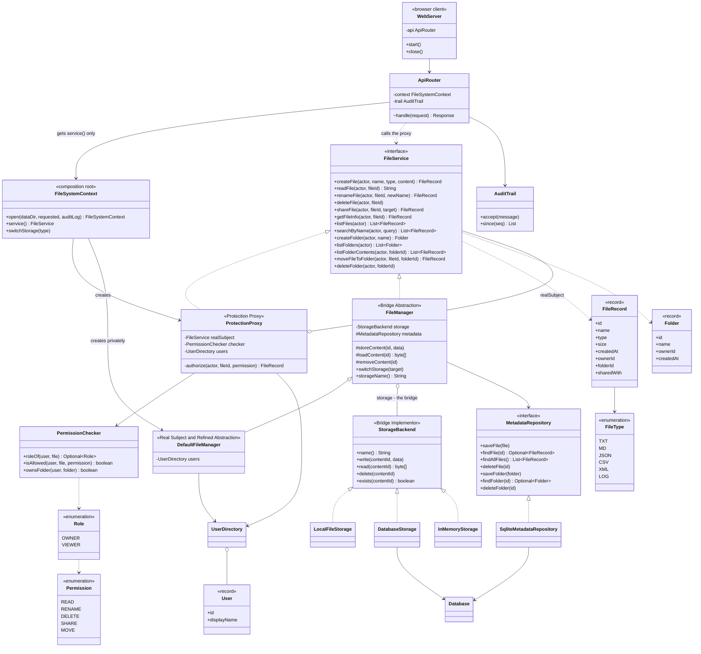
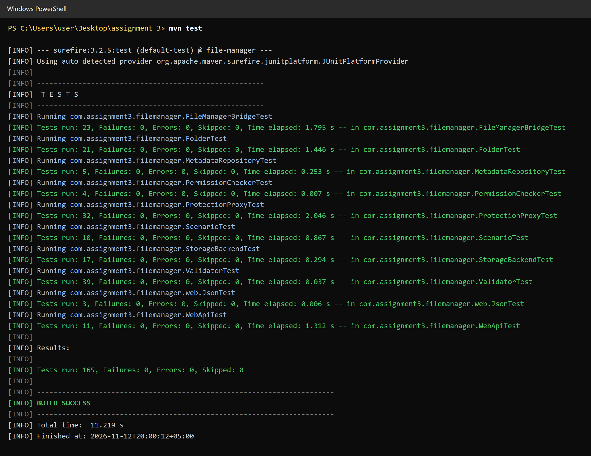
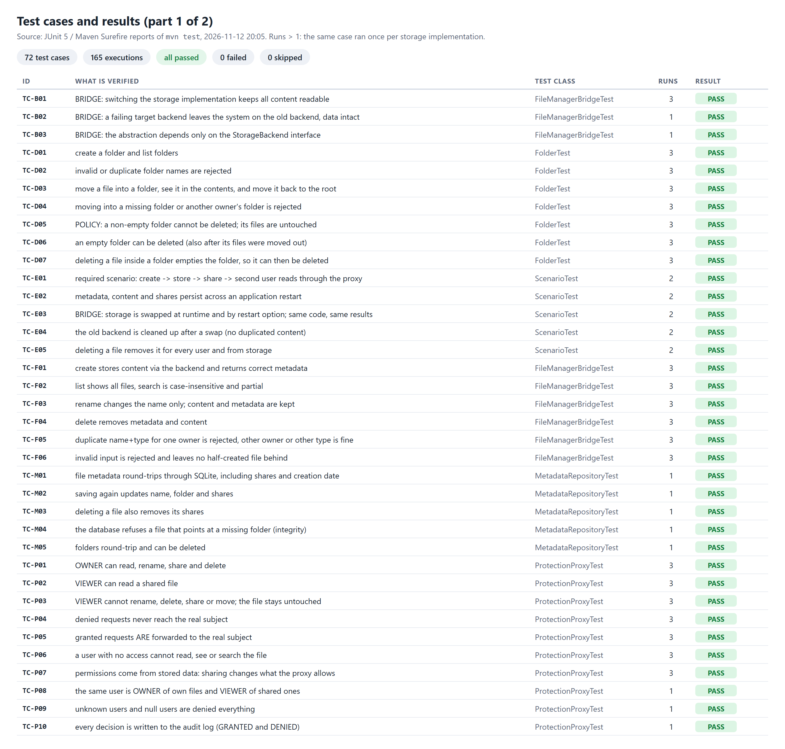
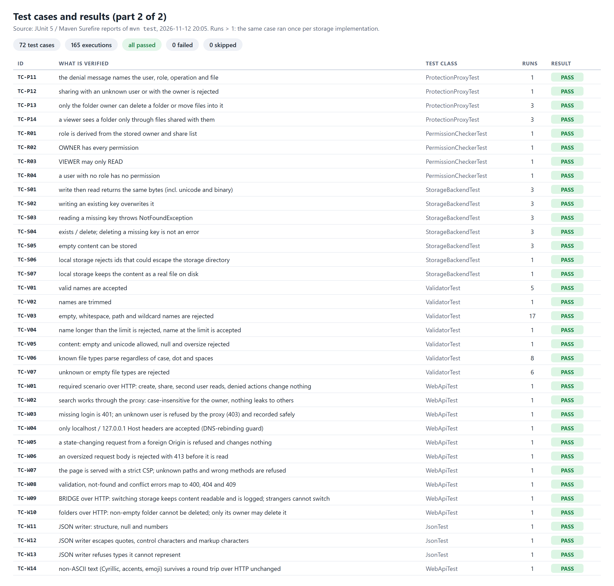

# File Management System - Bridge and Proxy Patterns (Assignment 3)

A file management system in Java 21 (console application, plus an optional browser interface on localhost) that lets
users create, search, rename, delete, share and organise files in folders. It demonstrates two design patterns working
together:

* **Bridge** - file management (the *abstraction*) is separated from where bytes are stored (the *implementation*).
  Two persistent storage back-ends are provided (local disk, SQLite database) plus an in-memory one for tests.
* **Proxy (Protection Proxy)** - every request passes through a proxy that checks the current user's permissions
  before the real file service is allowed to act.

| | |
|---|---|
| Language / build | Java 21, Maven 3.9 |
| Persistence | SQLite (file metadata, shares, folders) + local files **or** SQLite BLOBs (file content) |
| Dependencies | `sqlite-jdbc`, `slf4j-nop` (runtime); JUnit 5 (tests) |
| Deliverables | source code (`src/`), UML ([`docs/uml-class-diagram.puml`](docs/uml-class-diagram.puml) and below), this README, test cases + results ([`docs/TEST_REPORT.md`](docs/TEST_REPORT.md)) |

## At a glance

How a request travels: every client goes through the proxy, and the file manager reaches the storage only through
the `StorageBackend` interface.



The full UML class diagram is in [section 4](#4-uml-class-diagram).

## What is submitted

| Required | Where |
|---|---|
| Complete source code | [`src/main/java`](src/main/java) (application), [`src/test/java`](src/test/java) (tests), [`pom.xml`](pom.xml) |
| UML class diagram | [section 4 below](#4-uml-class-diagram): picture ([`docs/images/uml-class-diagram.png`](docs/images/uml-class-diagram.png)), text diagram rendered by GitHub, and the PlantUML source [`docs/uml-class-diagram.puml`](docs/uml-class-diagram.puml) |
| README file | this file: build and run, features, architecture, how Bridge reduces coupling, the required scenario |
| Test cases and results | [`docs/TEST_REPORT.md`](docs/TEST_REPORT.md): every test case with its ID, what it checks and its result (72 cases, 165 executions, all passed). Screenshots of the run and of every test case right after the UML diagram ([Test results at a glance](#test-results-at-a-glance)); summary in [section 9](#9-tests). Reproduce with `mvn test`. |

---

## 1. Build and run

Requirements: JDK 21+ and Maven.

```bash
mvn clean package            # compiles, runs the 165 tests, builds target/file-manager.jar
java -jar target/file-manager.jar --demo            # scripted demonstration of the whole scenario
java -jar target/file-manager.jar                   # interactive console (data stored in ./data)
java -jar target/file-manager.jar --web             # browser interface on http://localhost:8421/
```

Options: `--storage=local|database` (choose / switch the storage implementation), `--data-dir=PATH`,
`--port=N` (with `--web`; default 8421), `--quiet` (hide the `[PROXY]` permission-decision lines in the terminal).

Run only the tests: `mvn test`. Skip them while packaging: `mvn package -DskipTests`.

### Simulated users

There is no registration or login. Three users are predefined in `UserDirectory`: **beksultan**, **ruslan**, **kuanysh**.
The console asks "Act as which user" at start-up and via menu option 13.

### Console menu

```
 Files:   1 create   2 list   3 search   4 read   5 info   6 rename   7 delete   8 share
 Folders: 9 create  10 list+contents  11 move file  12 delete folder
 System: 13 switch user  14 switch storage   0 exit
```

Short interactive example (Ruslan tries to rename a file Beksultan shared with him):

```
beksultan: 1 create -> name "report", type txt, content "..."      => Created report.txt (id f0d09978)
beksultan: 8 share  -> file f0d09978, user ruslan
13 switch user -> ruslan
ruslan:   4 read   -> f0d09978                                    => prints the content
ruslan:   6 rename -> f0d09978                                    => ! Access denied: ruslan (VIEWER) is not allowed to RENAME file 'report.txt'.
```

### Browser interface (optional)

`java -jar target/file-manager.jar --web`, then open **http://localhost:8421/** (port 8421 was chosen because it is
rarely used by other software; change it with `--port=`). The page offers everything the console offers and shows
the proxy's decisions live in the right-hand panel (green = GRANTED, red = DENIED).

* **Acting as** (top right) is the simulated login. It is remembered per browser tab, so you can open **two tabs** -
  beksultan in one, ruslan in the other - and watch the scenario from both sides.
* **Storage** shows the active `StorageBackend`; the *Switch* button swaps it at runtime (the Bridge) and migrates the
  content. The switch appears in the log as `[BRIDGE]`.
* All action buttons stay enabled for every role on purpose, so you can try a forbidden action (for example *Rename* as
  a viewer) and see the red "Access denied" message produced by the proxy.

The browser is just one more **client of `FileService`**: `web/ApiRouter` (behind `WebServer`) receives only the proxy from
`FileSystemContext.service()`, so the web layer cannot bypass a permission check. It uses the JDK's built-in HTTP server
(no extra dependency). Safety measures: the server listens on `127.0.0.1` only (not reachable from the network); the
`Host` header must be localhost; state-changing requests with a foreign `Origin` are refused and every API call needs the
custom `X-User` header (which a cross-site form cannot send); request bodies are limited to 4 MB; only the three page files
(`index.html`, `app.js`, `style.css`) are served, from a fixed whitelist; the page has a strict Content-Security-Policy and inserts file names / contents as plain text,
never as HTML. Errors map to HTTP codes: validation 400, access denied 403, not found 404, conflict 409.

| Method and path | Purpose |
|---|---|
| `GET /api/session` | users, active storage |
| `GET /api/files[?q=text]`, `POST /api/files` | list / search, create (`name`, `type`, `content`) |
| `GET /api/files/{id}`, `GET /api/files/{id}/content`, `DELETE /api/files/{id}` | info, read, delete |
| `POST /api/files/{id}/rename`, `/share`, `/move` | rename (`name`), share (`target`), move (`folderId`, blank = root) |
| `GET/POST /api/folders`, `GET/DELETE /api/folders/{id}` | list / create, contents / delete folder |
| `POST /api/storage` (`type`), `GET /api/log?since=N` | switch storage (Bridge), proxy decisions |

Every call except `/api/session` carries `X-User: beksultan|ruslan|kuanysh`.

---

## 2. Features (assignment checklist)

| Requirement | Where |
|---|---|
| Create file with name, content, type (`txt md json csv xml log`) | `FileService.createFile` |
| List files, search by name (case-insensitive, partial), rename, delete | `listFiles`, `searchByName`, `renameFile`, `deleteFile` |
| File info: name, type, size, creation date (+ owner, folder, shares, your role) | `getFileInfo`, `Display.fileDetails` |
| Folders: create, list with contents, move a file in/out, delete | `createFolder`, `listFolders`, `listFolderContents`, `moveFileToFolder`, `deleteFolder` |
| **Roles** Owner / Viewer | `Role`, `Permission`, `PermissionChecker` |
| **Bridge** with 2+ storage implementations | `FileManager` -> `StorageBackend` -> `LocalFileStorage`, `DatabaseStorage`, `InMemoryStorage` |
| **Protection Proxy** for read / rename / delete (+ share, move, folders) | `ProtectionProxy` |
| Bridge + Proxy together in the required scenario | `FileSystemContext`, `DemoRunner`, test `TC-E01` |
| Persistent metadata and content | SQLite file `data/filemanager.db`, `data/files/*.dat` |
| Input validation, common errors handled | `Validator`, exception hierarchy, see section 7 |
| UML, README, tests with documentation | `docs/`, this file |

### Roles are per file

"Owner" and "Viewer" describe a user's relationship **to one file**, not a property of the user:

* The user who creates a file is its **Owner**: read, rename, delete, share, move.
* Users the file is shared with are **Viewers**: read only. No rename, delete, share or move.
* Everyone else has **no access**: they cannot read the file, get its info, or even see it in lists and search results.

So beksultan is Owner of her own files and Viewer of files ruslan shares with her. The proxy decides from the data that is
actually stored with each file (`ownerId` and the `file_shares` table), not from a hard-coded user list.

### Decision: deleting a folder that contains files

> **A folder that still contains files cannot be deleted.** The request is rejected with a `ConflictException`
> ("Folder 'docs' is not empty (1 file). Move or delete its files first."), and nothing is changed.

Reason: it can never destroy data by accident, and it keeps the rule obvious (an empty folder can be deleted; a
non-empty one cannot). Other rules that follow from folders being flat and owned:

* Folders have an owner and cannot be nested. Only the folder owner can delete it or move files into it.
* A file can only be moved into a folder with the same owner.
* A user who is not the folder owner sees a folder only if at least one file inside it is shared with them, and then
  sees only those files.

---

## 3. Architecture

```
 Client (ConsoleApp / DemoRunner / WebServer / tests)
        |  holds only a FileService reference
        v
 +--------------------+      same interface       +----------------------------------+
 |  ProtectionProxy   |  ---- FileService  ---->  |  DefaultFileManager              |
 |  checks permission |                           |  (Real Subject; extends          |
 |  denies or forwards|                           |   FileManager = Bridge abstraction)
 +--------------------+                           +------------+---------------------+
                                                       |       \
                                              storage  |        \ metadata
                                       (bridge: composition)     v
                                                       v     MetadataRepository (SQLite)
                                              <<interface>> StorageBackend
                                              /        |          \
                                 LocalFileStorage  DatabaseStorage  InMemoryStorage
```

`FileSystemContext` is the composition root: it builds the real subject, the proxy and the chosen storage, **keeps
the real subject private**, and only hands out the proxy through `service()`. A client therefore has no code path that
bypasses the permission checks.

### 3.1 Bridge pattern

| Bridge role | Class |
|---|---|
| Abstraction | `FileManager` (abstract) - holds `private StorageBackend storage` |
| Refined abstraction | `DefaultFileManager` - the file and folder rules |
| Implementor | `StorageBackend` (interface): `write`, `read`, `delete`, `exists`, `name` |
| Concrete implementors | `LocalFileStorage`, `DatabaseStorage`, `InMemoryStorage` |

* The abstraction is connected to the implementor **by composition** (the `storage` field), never by inheritance.
* `FileManager` reaches storage only through three protected methods (`storeContent`, `loadContent`,
  `removeContent`). It never names a concrete backend (test `TC-B03` checks this with reflection).
* **The implementation can be changed without modifying the abstraction:**
  * at start-up - `--storage=database` selects another implementor;
  * at run time - `FileManager.switchStorage(...)` (console option 14) copies all content to the new backend,
    swaps the link, then cleans the old backend. If the copy fails, the system stays on the old backend with
    all data intact (`TC-B02`).
  * `FileManager`, `DefaultFileManager`, `FileService` and `ProtectionProxy` are untouched by either change.
* Adding a fourth backend (cloud, encrypted, ...) means writing one class that implements `StorageBackend` and one
  line in `StorageFactory`. No file-management code changes.
* File **metadata** is deliberately independent of the content store: it always lives in the SQLite
  `MetadataRepository`, whichever backend holds the bytes.

#### How the Bridge reduces coupling

Without the Bridge, one `FileManager` class would contain `if (local) {...} else {...}` for every operation, or there
would be `LocalFileManager`, `DatabaseFileManager`, and every new feature (say, a different permission rule or
a new file operation) would have to be written once per storage type: *M* behaviours x *N* storages classes.
With the Bridge:

1. **File-management code depends on an interface, not on disks or SQL.** Changing how bytes are stored cannot
   break validation, naming or folder rules, and vice versa.
2. **The two hierarchies grow independently** - *M* + *N* classes instead of *M* x *N*.
3. **Testing is cheap and strong** - the identical test suite runs against every backend
   (the `Kind` parameter in the tests), which proves the abstraction does not depend on any one of them.
4. **The storage decision is made in exactly one place** (`StorageFactory`) and can be changed at run time.
5. **Technology details stay contained**: path-traversal protection lives only in `LocalFileStorage`; SQL for content
   lives only in `DatabaseStorage`.

### 3.2 Proxy pattern (Protection Proxy)

| Proxy role | Class |
|---|---|
| Subject (common interface) | `FileService` |
| Real Subject | `DefaultFileManager` (performs the operations, does no authorisation) |
| Protection Proxy | `ProtectionProxy` (checks, then forwards or throws `AccessDeniedException`) |

For each restricted operation the proxy loads the file's stored permission data, asks `PermissionChecker` for the
user's role, and only then calls the real subject:

| Operation | Owner | Viewer | No access |
|---|:-:|:-:|:-:|
| read / file info | yes | yes | no |
| rename | yes | no | no |
| delete | yes | no | no |
| share | yes | no | no |
| move to folder | yes | no | no |
| list / search | sees own + shared files | sees shared files | sees nothing of that file |

* Unknown or `null` users are rejected for every operation.
* A denied request is **never forwarded** to the real subject (`TC-P04` proves it with a recording spy).
* Every decision is logged as a `[PROXY] user -> OPERATION file 'id' : GRANTED|DENIED (ROLE)` line.
* Denial messages say who, what and why: `Access denied: ruslan (VIEWER) is not allowed to RENAME file 'report.txt'.`

### 3.3 The required scenario, step by step

| # | Scenario step | What happens in the code |
|---|---|---|
| 1 | A user creates a file | `ProtectionProxy.createFile` -> `DefaultFileManager.createFile`; owner = beksultan |
| 2 | Stored using the selected storage | `FileManager.storeContent` -> `StorageBackend.write` (file on disk **or** BLOB row); metadata saved in SQLite |
| 3 | Owner shares with another user | `shareFile`: proxy checks `SHARE` (OWNER only), `file_shares` row added |
| 4 | Second user attempts to read | `ProtectionProxy.readFile(ruslan, id)` |
| 5-6 | Proxy checks permissions | `PermissionChecker.roleOf` -> VIEWER -> READ allowed |
| 7 | Access granted: file retrieved through the abstraction and its storage | `DefaultFileManager.readFile` -> `loadContent` -> `StorageBackend.read` |
| 8 | Access denied: rejected | before sharing (or for kuanysh) the proxy throws `AccessDeniedException`; the real subject is never called |

This exact scenario is executed by `--demo` and by the automated test `TC-E01` (for both persistent storages).

---

## 4. UML class diagram



*Click the picture to open it full size. Blue classes form the **Bridge**, orange classes the **Protection Proxy**.
The picture shows the key classes; the complete member lists are in the PlantUML source.*

The same design is available as text: the PlantUML source
[`docs/uml-class-diagram.puml`](docs/uml-class-diagram.puml) (complete diagram with all packages and members) and the
Mermaid diagram below, which GitHub and the IntelliJ / VS Code Markdown preview render directly.



### Test results at a glance

`mvn test` runs **72 test cases (165 executions): 0 failed, 0 skipped**. The console output of that run:



Every test case with its ID, what it verifies and its result (part 1 of 2, then part 2):





*The pictures are rendered from the real `mvn test` output and from the table in
[`docs/TEST_REPORT.md`](docs/TEST_REPORT.md), which is generated from the Surefire reports (they are not window
captures). To reproduce the run yourself: `mvn test`.*

---

## 5. Persistence

| Data | Where |
|---|---|
| File metadata (id, name, type, size, creation time, owner, folder) | SQLite table `files` |
| Shares (who can view which file) | SQLite table `file_shares` (foreign key to `files`, `ON DELETE CASCADE`) |
| Folders | SQLite table `folders` (files reference them with a foreign key) |
| File content - **LOCAL** storage | `data/files/<id>.dat` |
| File content - **DATABASE** storage | SQLite table `file_content` (BLOB) |
| Which storage is active | SQLite table `settings` (key `storage`) - remembered across restarts |

Everything lives under `data/` (git-ignored). Delete the folder to reset. File timestamps are stored as epoch
milliseconds. Metadata writes run in transactions (commit / rollback). If the metadata write fails after the content
was written, the content is removed again so no orphan is left.

Starting with `--storage=...` different from the stored choice migrates the existing content automatically.

## 6. Encapsulation and access modifiers

* Domain objects are immutable `record`s (`FileRecord`, `Folder`, `User`); changes create copies (`withName`, ...).
* The Bridge link `storage` is `private` in `FileManager`; subclasses reach it only via `protected final` methods.
* `DefaultFileManager` is created only inside `FileSystemContext` and stored in a private field - clients get the
  proxy. `ConsoleApp`, `Display` and `DemoRunner` are package-private.
* The permission rules are `private` helpers and a stateless `PermissionChecker`; `Validator` and the factories are
  `final` with private constructors.
* `LocalFileStorage` derives file names from generated ids restricted to `[A-Za-z0-9_-]`,
  so a hostile name such as `../../x` can never escape the storage directory (`TC-S06`).

## 7. Input validation and error handling

| Input | Rule | Error |
|---|---|---|
| File / folder name | not blank, max 100 chars, none of `\ / : * ? " < > |` or control chars, not `.`/`..`, no trailing dot | `ValidationException` |
| File type | one of `txt md json csv xml log` (case and leading dot ignored) | `ValidationException` |
| Content | not null, max 1,000,000 bytes (UTF-8) | `ValidationException` |
| Duplicate file name + type for the same owner (also on rename) | rejected | `ConflictException` |
| Duplicate folder name for the same owner | rejected | `ConflictException` |
| Unknown file / folder / user id | rejected | `NotFoundException` |
| Share with the owner, or with an unknown user | rejected | `ValidationException` / `NotFoundException` |
| Delete a non-empty folder; move into another owner's folder | rejected | `ConflictException` |
| No permission | rejected by the proxy | `AccessDeniedException` |
| Disk or database failure | wrapped, original cause kept | `StorageException` |
| Menu input that is not a menu number | message, menu shown again | handled in `ConsoleApp` |

All of these extend `FileManagerException`; the console catches it per action, prints the message and keeps running,
so a bad input never crashes the program. End of input (Ctrl+Z / Ctrl+D) exits cleanly.

## 8. Demo output (excerpt of `--demo`)

```
=== Step 4: Kuanysh has no access yet -> read is DENIED by the proxy ===
[PROXY] kuanysh -> READ file 'f0d09978' : DENIED (NO ACCESS)
  [REJECTED] kuanysh reads report
             AccessDeniedException: Access denied: kuanysh has no access to file 'report.txt'.

=== Step 5: Beksultan (OWNER) shares the file with Ruslan ===
[PROXY] beksultan -> SHARE file 'f0d09978' : GRANTED (OWNER)

=== Step 6: Ruslan (VIEWER) reads: proxy checks permission, then FileManager -> storage ===
[PROXY] ruslan -> READ file 'f0d09978' : GRANTED (VIEWER)
  content: "Q3 report: revenue up 12%. / Confidential."

=== Step 7: Ruslan (VIEWER) tries restricted operations -> all DENIED ===
[PROXY] ruslan -> RENAME file 'f0d09978' : DENIED (VIEWER)
             AccessDeniedException: Access denied: ruslan (VIEWER) is not allowed to RENAME file 'report.txt'.
[PROXY] ruslan -> DELETE file 'f0d09978' : DENIED (VIEWER)
[PROXY] ruslan -> SHARE  file 'f0d09978' : DENIED (VIEWER)

=== Step 11: BRIDGE: swap the storage implementation at runtime ===
  Storage changed local -> database  (DefaultFileManager / FileService / ProtectionProxy were not modified)
[PROXY] ruslan -> READ file 'f0d09978' : GRANTED (VIEWER)
  content: "Q3 report: revenue up 12%. / Confidential."
```

The demo continues with persistence across a restart and clean-up. Run it to see the full output.

## 9. Tests

`mvn test` runs **72 test cases / 165 executions** (JUnit 5): validation, the storage contract on every backend,
file and folder rules, the Bridge (including swapping and failure rollback), the Proxy (granted, denied, not forwarded,
audit log, folders), SQLite persistence, end-to-end scenarios with restarts, and the browser API over real HTTP
(`TC-W01` - `TC-W14`: the scenario through HTTP, localhost-only protection, error codes, Unicode, JSON escaping).
Full table with IDs and results: **[docs/TEST_REPORT.md](docs/TEST_REPORT.md)**; screenshots of the run and the
table: [Test results at a glance](#test-results-at-a-glance).

## 10. Project structure

```
pom.xml
README.md
docs/
  uml-class-diagram.puml      PlantUML source of the class diagram
  images/                     UML picture and test-result screenshots used in this README
  TEST_REPORT.md              test cases and results
src/main/java/com/assignment3/filemanager/
  app/         Main, ConsoleApp, DemoRunner, Display, FileSystemContext (composition root)
  web/         WebServer (HTTP server, static page), ApiRouter (API routes -> proxy), Request, Response, HttpError,
               AuditTrail (live proxy log), Json (tiny JSON writer)
  service/     FileService (Subject), FileManager (Bridge abstraction), DefaultFileManager (Real Subject)
  proxy/       ProtectionProxy, PermissionChecker
  storage/     StorageBackend (Implementor), LocalFileStorage, DatabaseStorage, InMemoryStorage, StorageFactory, StorageType
  repository/  MetadataRepository, SqliteMetadataRepository, Database
  model/       User, UserDirectory, FileRecord, Folder, FileType, Role, Permission
  exception/   FileManagerException + Validation / NotFound / Conflict / AccessDenied / Storage exceptions
  util/        Validator
src/main/resources/web/       index.html, app.js, style.css (the browser interface)
src/test/java/com/assignment3/filemanager/   9 test classes + TestSupport (+ web/JsonTest)
```

## 11. Known limitations

* Users are simulated (a fixed list); there is no authentication - the "current user" is whoever you choose in the menu.
* Single process; the web server runs business operations one at a time (a lock), and the console is one user at a time.
  The browser interface is for local demonstration only (loopback, simulated login); it is not meant to be exposed to a network.
* Content is text (UTF-8), up to 1 MB per file; folders are flat (no nesting).
* Roles are Owner and Viewer only; sharing cannot be revoked (not required by the assignment).
* `InMemoryStorage` is not persistent; it exists for tests and to show how cheaply another implementor is added.
